# UIII Act4  Importación y descripción de datos con Pandas ML
## Estephany Nicole Robles Mendoza NC 0120
## 🎓 Asignatura: Soluciona problemas de Machine Learning
## 📚 Nivel: Tercer semestre de preparatoria
## 🤖 Especialidad: Inteligencia Artificial
## 📈 Dificultad: Cero a principiante
## 🐍 Lenguaje: Python
## 🛠️ Herramientas: Visual Studio Code, Pandas, Matplotlib y CSV
## Estephany Nicole Robles Mendoza NC 0120

# Paquetería en tránsito
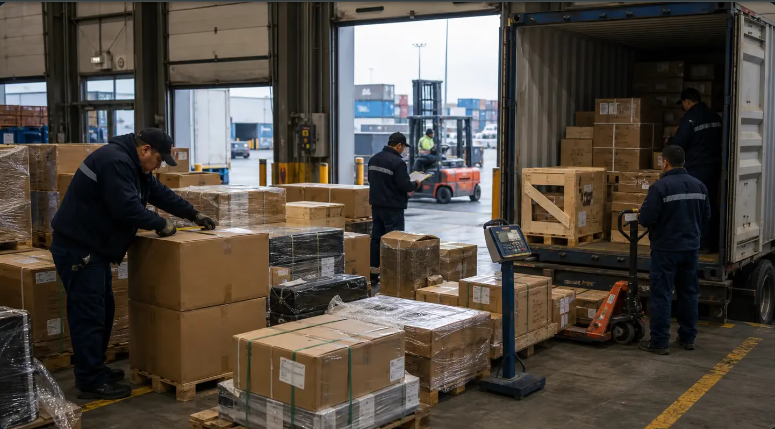
# Tabla original de paqueteria en transito
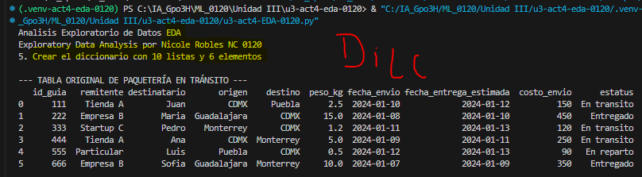
# 7. Convertir el DataFrame en archivo CSV
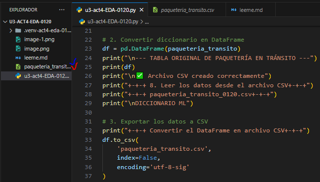
# Datos del cvs --> base de datos
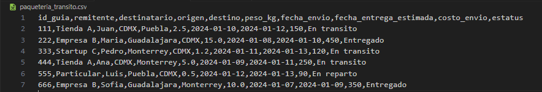
# Leer datos desde el archivo CSV
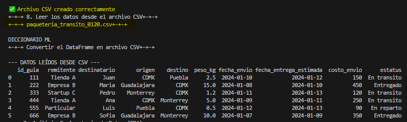
# Análisis Exploratorio de Datos(EDA)
# rimero y último registro
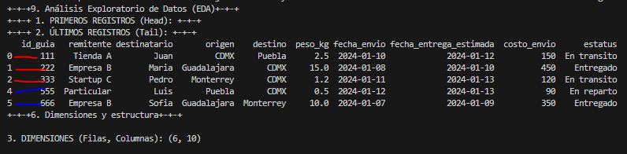
# 6. Dimensiones y estructura
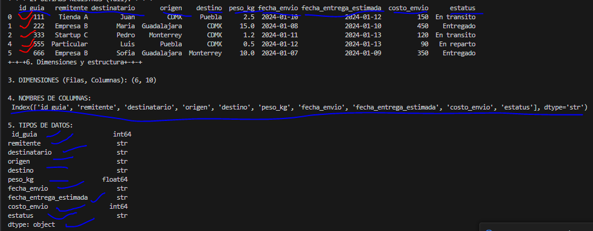
# 7. Estadísticas y limpieza
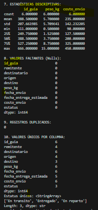
# 8 y 9 Ordenamiento, filtrado y agrupación
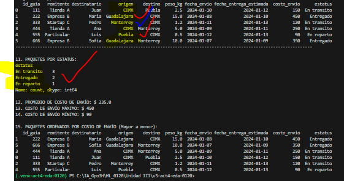
# 18. Gráfica de barras: Paquetes por estatus
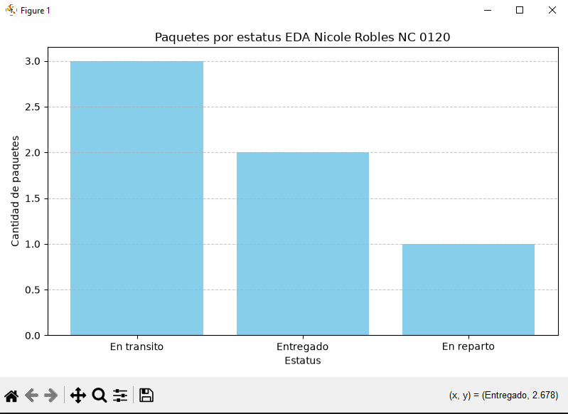
# 19. Gráfica de barras: Costo de envío por guía
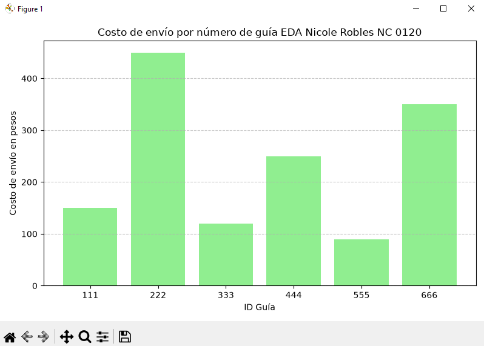
# 20. Histograma: Distribución de pesos
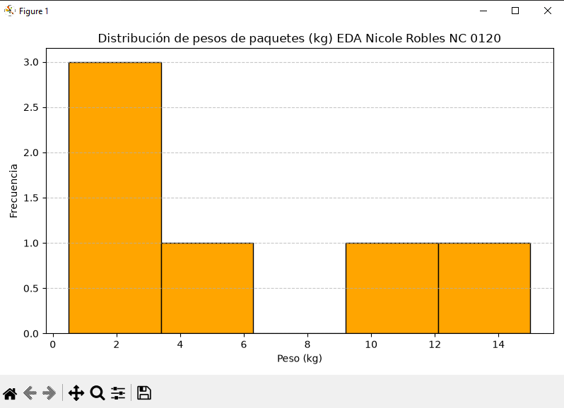
# 21. Gráfica de dispersión: Peso vs Costo de envío
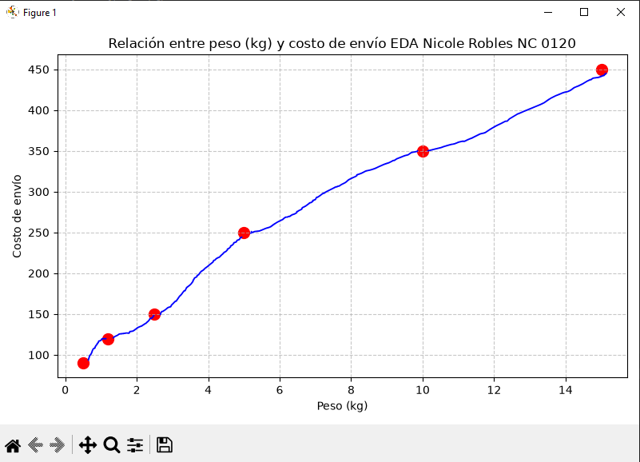
# 22. Diagrama de caja: Distribución de costos de envío
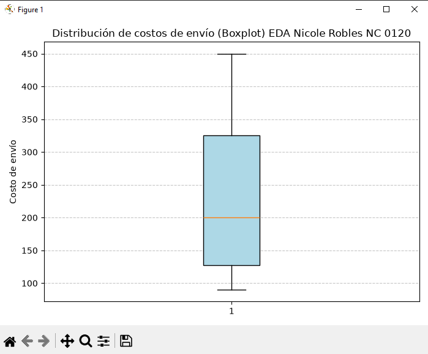
# 23. Matriz de correlación
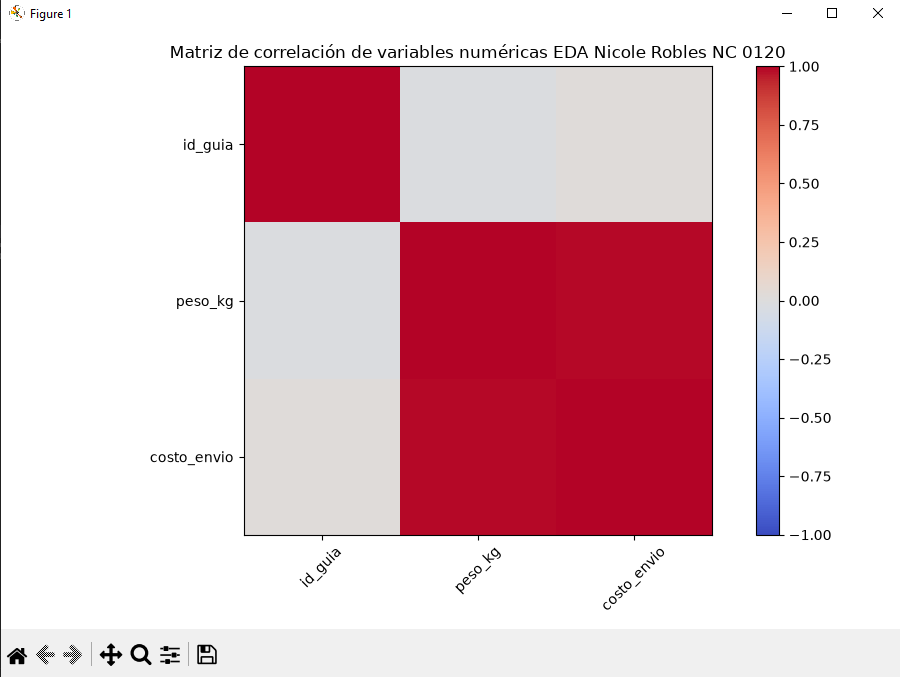